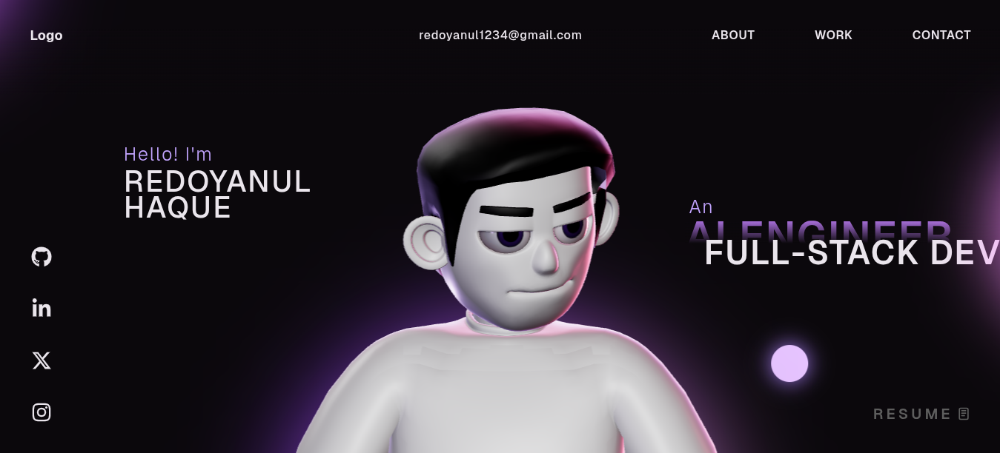

# 🚀 3D Developer Portfolio Website (React + TypeScript + Three.js)

[](./video.mp4)

A modern, high-performance **3D developer portfolio website** built with **React**, **TypeScript**, **Three.js**, **GSAP**, and **WebGL**.

If you’re a developer looking for a **portfolio template** that feels premium, interactive, and memorable—this repo is for you.

> Live preview: https://www.redoyanulhaque.me/

---

## ✨ Highlights

- **3D / WebGL experience** powered by **Three.js**
- Smooth animations with **GSAP**
- Modern **React + TypeScript** codebase
- Fast, responsive UI (desktop + mobile)
- Designed for developers, engineers, programmers, and creators

---

## 🧰 Tech Stack

- **React**
- **TypeScript**
- **Three.js / WebGL**
- **GSAP**
- **HTML / CSS / JavaScript**

---

## 🚀 Getting Started

### 1) Clone

```bash
git clone https://github.com/red1-for-hek/portfolio-website.git
cd portfolio-website
```

### 2) Install

```bash
npm install
```

### 3) Run locally

```bash
npm run dev
```

### 4) Build

```bash
npm run build
```

## Supabase setup

1. Create the admin user in **Supabase Dashboard → Authentication → Users**.
2. Run [`supabase_schema.sql`](./supabase_schema.sql) in the SQL Editor.
3. Copy the admin user's UUID and register it:

   ```sql
   INSERT INTO public.portfolio_admins (user_id)
   VALUES ('d94ef3cc-60bf-4a53-95a4-3691eca0cbc5');
   ```

4. Set `VITE_SUPABASE_URL` and `VITE_SUPABASE_ANON_KEY` in `.env`, then restart the development server.
5. Sign in at `/ghchgctydytceycj` using that Supabase Auth user's email and password.

The public anon key is intended for browser use. Never put a Supabase service-role key in the frontend. Row Level Security allows public portfolio reads and contact submissions, while portfolio edits, contact inbox access, and media uploads require a registered admin account.

If you already ran an older version of the schema, run the current `supabase_schema.sql` again so the updated admin-only Storage policies are installed.

---

## 🧩 Customize (Quick Guide)

Typical things you’ll want to update:

- **Your name + hero section text**
- **Projects list**
- **Social links** (GitHub, LinkedIn, email)
- **SEO meta title/description**

---

## ⭐ Support

If you found this useful:

- Please **star** the repository (it helps a lot)
- Share it with a friend who needs a portfolio template
- Sponsor via the **Sponsor** button on GitHub (if available in your region)

---

## 🤝 Connect

- LinkedIn: https://www.linkedin.com/in/red1-for-hek/

---

## 🏷️ Recommended GitHub Topics (add in repo settings)

Add these topics to improve GitHub search visibility:

`portfolio` `developer-portfolio` `portfolio-website` `portfolio-template` `3d-portfolio` `react` `typescript` `threejs` `webgl` `gsap` `frontend` `vite`

---

## 🪪 License

This project is open source and available under the **MIT License**. See [LICENSE](LICENSE).
